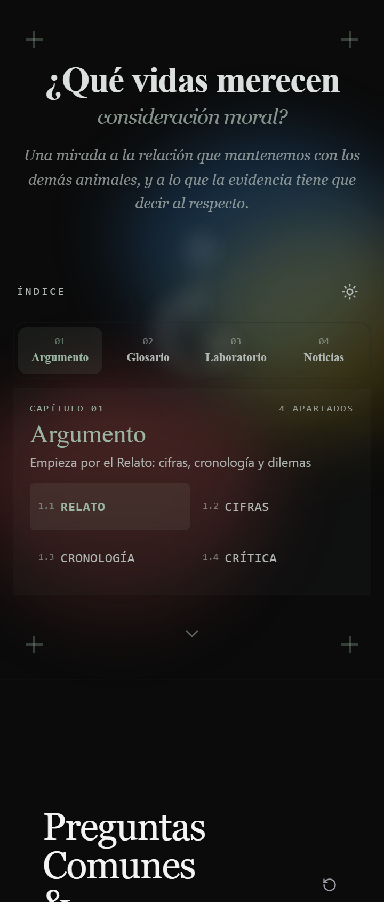
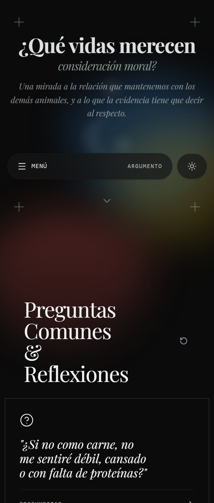
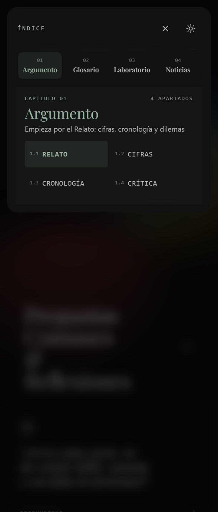
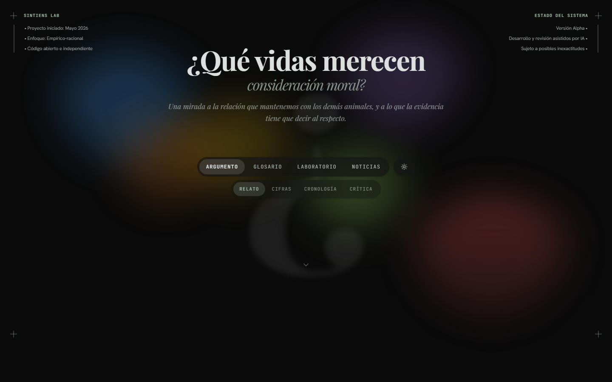

# Prototipos híbridos de navegación

Rama `prototipos-menu-hibrido`. **No desplegado**; producción sigue con el menú
antiguo (`deploy-20261020d`).

## Hybrid 1 — índice móvil siempre visible, escritorio antiguo

- Móvil: índice rediseñado con pestañas y página del capítulo, siempre visible.
- Escritorio: píldora antigua con submenú.

Abrir: `/?nav=hybrid1`

## Hybrid 2 — botón Menú antiguo que abre el índice rediseñado

- Móvil: botón «Menú · Argumento» como antes; al pulsarlo se abre una hoja con
  el índice rediseñado.
- Escritorio: píldora antigua con submenú.

Abrir: `/?nav=hybrid2`

## Escritorio

En ambos prototipos el escritorio es exactamente el menú antiguo:

